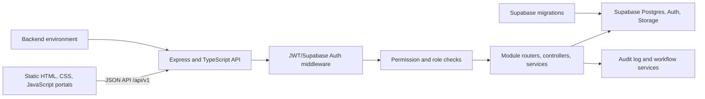

# IDMC iMIS Full System Audit

**Audit date:** 2026-10-07  
**Scope:** `C:\Users\liben\Documents\IDMC_iMIS` and the supplied `IDMC_iMIS (13).zip`  
**Result:** PARTIAL; application behavior against Supabase and real user accounts remains unverified.

## Executive finding

This is a sizeable Supabase-backed college MIS, not a single-page mockup. The working source contains 120 HTML pages, 85 frontend JavaScript files, an Express/TypeScript API, 119 Supabase SQL migrations, dedicated auth/RBAC middleware, and module-specific services/routes for admissions, academics, students, finance and institutional operations. Automated repository discovery found 797 route declarations and 63 conventional HTML forms. These counts are static discovery counts, not proof that each unique endpoint or form runs correctly.

The backend build and 156 local tests pass. The static integration audit reports 119 migrations, 797 route declarations, 63 conventional HTML forms, and zero failures. Library reservations now have a partial unique index allowing only one ACTIVE member/item pair; duplicate legacy reservations stop the migration for manual review. PGlite verifies duplicate prevention and replacement after cancellation; this migration is not deployed remotely. The student-engagement router was missing from the API mounts despite active frontend calls; it is now mounted and the HTTP regression test confirms requests reach the reservation handler. Cohort assignment UI supports paginated selection beyond 100 candidates with bounded multi-page selection; PGlite exercises core assignment/edit invariants, but the configured Supabase target still lacks the cohort columns and no remote migration was applied. Transcript generation now snapshots approved semester/course results, derives CGPA and writes an audit event in one service-role-only database transaction; review/approve/issue/revoke transitions are row-locked, four-eyes checked and audited transactionally. PGlite tests verify lifecycle success, permission grants and rollback without partial header/line/audit writes. Transcript CRUD cannot mutate lifecycle fields or snapshot lines. Registration approval now validates eligibility and writes registration state, approval history and audit atomically; generic registration and approval CRUD writes are disabled. HTTP route tests verify transcript search and snapshot authentication and permission denial. The institutional workspace supports authorized draft creation through student search and displays the stored transcript snapshot, in addition to permission-aware lifecycle actions. PGlite tests also exercise literal PostgreSQL email matching, serialized refund reservations and payment-edit guards, atomic Admissions verification and offer issuance, academic batch creation, resumable/idempotent import and atomic student/academic rollback, including ownership takeover, mismatch and forced transaction failures. Generic CRUD detail/write responses are projected onto declared resource fields; generic writes to calculated academic results, semester/GPA records, assessments and correction requests are disabled, while examination marks now use a validated draft-entry endpoint and ordered, audited two-person transitions. Direct CRUD writes to charges, invoices, payments and refunds are disabled in favor of controlled Finance Portal workflows, and refund actions use audited state transitions with requester self-approval blocked. Admissions applicant CRUD no longer accepts or infers Auth account links, while verified-email portal ownership remains enforced. Upload tests validate staff base64/signature/MIME/size rules and verify private-storage PDF/JPEG/PNG/WebP signatures in applicant, student, assessment, field-report, payment-receipt and Admissions source routes. Student, Admissions and Finance document download tests cover same-project legacy URL conversion, encoded traversal rejection and entity-prefix scoping. These checks do not scan for malware or fully parse file structures. HTTP/source-contract tests enforce verified applicant email ownership, reject student-account reassignment conflicts, prevent unconfirmed email-based account healing, prove email healing rejects both an already-linked profile and a concurrent owner assignment, and ensure Student Portal, Student Engagement, staff workspace and operations errors use sanitized responses. Staff acceptance and decline now use an atomic, service-role-only RPC that synchronizes acceptance, offer, application and audit with rollback coverage in PGlite plus HTTP route tests; its new migration remains local. Staff Operations is now mounted with staff-institution scope, explicit field projections and role-gated access; mocked HTTP tests verify deny paths and exclude payroll salary/bank details. Cohort programme-version reference data is restricted to active IDMS programmes and has a source-contract regression check. The legacy workflow application-conversion endpoint now requires `admissions.manage`; an HTTP regression test confirms unauthorized students are denied before the application record or conversion RPC is touched. A source-contract guard checks that every workflow write route declares a permission guard. Workflow audit insertion failures emit a structured sanitized error; the operation and its audit event remain separate writes and are not atomic. A live database connection to the full schema, migration state, authentication, persistence, portal access, exports and the historical import/login journey remain unverified.

**IDMC iMIS SYSTEM READINESS SCORE: 53/100 (evidence-limited).** The score reflects broad architecture and a passing local suite, offset by missing live-system evidence and an unapplied/unverified migration. It is not a certification or production sign-off.

## System map

- **Frontend:** `apps/frontend/`; static HTML pages and shared JS/CSS assets; custom `server.mjs` serves local pages.
- **Backend:** `apps/backend/src/`; Express server, middleware, routes, module services, config and utilities; TypeScript output is `apps/backend/dist/`.
- **Database:** Supabase/Postgres via `apps/backend/src/config/database.ts`; service-role client is server-side. Authenticated-user operations need the separate client flow. RLS and app-level permission checks both matter.
- **Schema history:** `supabase/migrations/` is designated authoritative by `supabase/MIGRATION_POLICY.md`; `database/migrations/` and schema snapshots are reference/diagnostic material. The current static audit reports 114 migration files; remote application state remains unknown.
- **Cross-cutting services:** auth/RBAC middleware, request context, error handling, logging, performance/cache middleware, audit logging, notification/email, and student portal account linking.

## Module coverage and status

Status is based on source presence, route/form discovery, automated tests, and limited local HTTP checks. **PARTIAL** means there is meaningful implementation but not end-to-end evidence. Source presence alone is not a pass.

| Area | Status | Evidence and remaining limit |
|---|---|---|
| Backend/API runtime | PARTIAL | TypeScript build succeeded; server started; `/api/v1/health` and `/api/v1` returned 200. No sustained/load test. |
| Frontend/runtime | PARTIAL | Static server started; login, historical-student and cohort pages returned 200. This does not execute authenticated UI flows. |
| Authentication | PARTIAL / rollout pending | Source rejects student number as a password, removes login-time account creation/auto-activation, offers rate-limited recovery links to linked accounts, and requires current-password reauthentication for password changes. Real Auth, SMTP and legacy-account recovery remain unverified; deployment is pending. |
| RBAC/permissions | PARTIAL | Permission middleware and role/permission migrations exist; unit tests cover allow/deny cases. No live role assignment/session tests. |
| Applications/admissions | PARTIAL | Applicant/admissions forms and routes exist. Bulk verification now advances eligible applications to VERIFIED; live offering/acceptance/conversion is unverified. |
| Student records/portal | PARTIAL | Student management, self-service endpoints, portal pages and ownership tests exist. No real student session was tested. |
| Historical student onboarding | PARTIAL | Validate/preview/import/resume/retry/rollback and historical academic workflows have UI, API, schema and tests. PGlite verifies atomic student rollback and academic rollback with GPA/CGPA recalculation; live DB import, identity provisioning, login and own-record visibility were not executed. |
| Cohort management | PARTIAL | Page/API, role permissions, audited CRUD, roster paging, IDMS-scoped assignment/removal, capacity controls and CSV export are implemented. PGlite validates five migrations and core RPC invariants. Authenticated HTTP tests with mocked Supabase cover view-only denial, authorized assignment, CSV contents/tenant filtering, audit call and export limit. Configured Supabase lacks the cohort fields (`42703`); full-schema deployment, live RLS and real-user E2E remain unverified. |
| Academic management | PARTIAL | Course, programme, offering, registration, attendance, timetable, assessment, examination, results and transcript routes/migrations are present; focused unit tests pass. Cross-module persistence against the configured database is unverified. |
| Finance | PARTIAL | Finance/invoice/payment workflow routes, migrations and tests exist. No payment provider, receipt upload, ledger or balance was exercised against a live database. |
| HR/staff and other portals | PARTIAL | Backend and page breadth includes HR, staff, leadership, governance, hostel, library, procurement, inventory, research, QA, communications, documents and helpdesk. Coverage varies; real role navigation is unverified. |
| Reports/exports | PARTIAL | Report pages/routes exist. Export/download correctness and authorization were not verified end to end. |
| Database/migrations | PARTIAL | Migration inventory and version uniqueness check pass; read-only Supabase readiness succeeds. Direct field checks show the new cohort migration is absent from the configured database (`42703`). No Supabase CLI/psql executable was available; full remote migration ledger/schema comparison was not performed. |
| Security | PARTIAL | Institution scoping was added to cohort API/RPC operations. Cohort assignment rejects inactive/archived and programme-incompatible students in the API preflight and final database write, and raises a serialization error when rows change eligibility before commit. Cohort edits lock the same row and atomically enforce roster capacity/programme rules. Student-number passwords are rejected; setup/reset uses recovery email; authenticated password changes verify the current password. Verified-email identity repair only claims unlinked legacy profiles and uses a conditional write, preventing takeover of profiles already attached to another Auth identity. Email and username ILIKE lookups escape wildcard characters. Private storage upload routes verify basic file signatures against declared MIME; malware scanning and real storage policy validation remain unverified. The production dependency audit also confirmed proxy-addr 2.0.8 (patched version) and zero production dependency advisories. Rollout and legacy-account validation remain. Helmet, exact CORS allowlist, rate limiting, auth/RBAC, audit logging, input checks and log-redaction tests exist. User/role audit IP handling ignores spoofed forwarded headers, and audit/service routes now consume middleware-normalized request IDs. No penetration or live RLS test was run. |
| Performance | PARTIAL | Cache/compression/performance middleware and index migrations exist. No representative dataset benchmark or load test. |

### Major features named in the brief

| Feature group | Classification |
|---|---|
| Dashboard, system health, users, roles, audit logs | PARTIAL; pages and routes exist, operational data not live-tested |
| Applications and admissions | PARTIAL; workflows exist; bulk verification now applies the verified transition, while downstream live transitions remain unverified |
| Students and historical students | PARTIAL; records/import lifecycle is implemented in source, full identity journey not tested |
| Programmes, departments, schools, academic years, semesters, intakes, curriculum, offerings | PARTIAL; schema/routes are distributed across academic modules; cohort management is implemented but awaiting database-backed verification |
| Registration, attendance, assessment, examinations, results, transcripts, timetable | PARTIAL; service/API/migration support and focused tests exist |
| Fees, invoices, finance, payments, receipts | PARTIAL; source workflows exist; external/payment/database operations not verified |
| Documents, notifications, reports, exports | PARTIAL; modules/routes exist; storage, delivery and download behavior unverified |
| Director, Principal, Registrar, Academic, Finance, Admissions, Lecturer, Student, Administrator portals | PARTIAL; pages and shared role checks exist; a real account for each role was unavailable |
| Cohort creation, editing, activation, student transfer and export | PARTIAL; implemented in source, awaiting database-backed verification |
| Production operations: backups, restore, migration deployment and monitoring | BLOCKED from verification; scripts/docs exist but no production-like environment was used |

## Forms and workflows

The structural audit found 63 `<form>` elements across the static frontend. JavaScript-driven controls and forms without conventional `<form>` wrappers may be undercounted; the inventory does not verify validation, permissions, submit handlers, API contract, or persistence.

The historical student page exposes file validation, preview, save-batch, confirm/resume, manual entry, data quality, import history and batch retry/rollback controls. Backend routes use historical-student permissions and the tests cover parsing, validation and resumable workflow logic. Database and identity outcomes remain unverified.

The cohort page and server workflow are now implemented. It includes programme/version, academic year, intake, admission year, dates, study mode, campus, capacity, status and notes; supports filters, create/edit/status changes, roster paging, authorized assignment/removal/transfer and CSV export. The additive migration adds unique-code semantics, validations, role grants and capacity-safe assignment/count functions. Database-backed verification remains required before the feature can be marked working.

## Score breakdown

| Dimension | Score / 10 | Basis |
|---|---:|---|
| Architecture | 8 | Distinct frontend/API/database layers and module structure exist. |
| Backend | 7 | Build and all 111 suite checks pass; database-backed behavior remains unknown. |
| Frontend | 6 | Cohort page and assets are served; authenticated browser behavior remains unverified. |
| Database | 4 | 116 migration files and a declared source of truth; remote state unknown. |
| Authentication | 5 | Dedicated flows/tests exist; live login and reset not checked. |
| RBAC | 5 | Middleware and permission tests exist; no real role sessions or RLS checks. |
| Academic management | 6 | Multiple academic workflows and focused tests exist; integration remains partial. |
| Historical students | 5 | Import lifecycle is implemented/tested locally; no real import-to-login proof. |
| Student portal | 5 | Portal and self-service endpoints exist; no authenticated end-to-end proof. |
| Other portals | 4 | Numerous pages/modules, uneven tested coverage. |
| Performance | 5 | Middleware and indexes exist; no representative benchmark. |
| Security | 4 | Baseline controls/tests exist; no live RLS or penetration validation. |
| UI/UX | 5 | Broad role-specific pages; cohort UX is implemented but not browser-tested with an account. |
| Testing | 8 | All 135 tests pass after build; no authenticated browser/DB E2E. |
| Production readiness | 3 | Health endpoint works locally; migration, backup, monitoring and data-path readiness unknown. |

## Evidence limits

The archive contains 14,345 ZIP entries rooted at `IDMC_iMIS/`, including a large npm cache. The requested target directory already contains the assembled project; it was inspected in place rather than extracting a second copy over it. The static and test evidence in this report applies to that target directory. No remote production data was read or modified. An `.env` file is present, but its values and validity were not disclosed or used as evidence of a successful database connection.

## Backend module directory inventory

All directories below contain source. **PARTIAL** means the module exists in code, but this audit did not establish complete persistence and role behavior against the configured database. All 153 local tests pass; live database-backed behavior is not established.

| Backend module directories | Classification |
|---|---|
| `auth`, `users`, `audit`, `system` | PARTIAL — identity/admin code and focused tests; live account and permission checks not run |
| `cohorts` | PARTIAL — cohort CRUD/roster/assignment/export code and focused structural tests; migration not applied |
| `applications`, `admissions`, `applicant-self-service`, `historical-students` | PARTIAL — workflow code/tests; admissions verification transition corrected; live record lifecycle unverified |
| `academic-core`, `academics`, `registration`, `attendance`, `assessment`, `examinations`, `results`, `timetable`, `transcripts` | PARTIAL — API/schema/test coverage exists; no live linked-record journey |
| `students`, `student-management`, `student-self-service`, `student-requests`, `student-engagement`, `self-service-actions` | PARTIAL — student/admin/self-service APIs exist; no real student session/data-scope test |
| `graduation`, `lifecycle-completion`, `alumni` | PARTIAL — lifecycle routes and migration/tests exist; graduation-to-alumni data not exercised live |
| `finance` | PARTIAL — finance workflow code/tests exist; no live ledger/payment reconciliation |
| `hr`, `staff-operations`, `staff-workspace` | PARTIAL — staff routes/pages exist; role-specific CRUD and account lifecycle not exercised live |
| `operations`, `procurement`, `inventory` | PARTIAL — operational routes/pages exist; transaction and export behavior unverified |
| `hostel`, `library` | PARTIAL — service modules/pages exist; no live borrower/resident workflow |
| `research`, `qa` | PARTIAL — module source/pages exist; no full review/approval lifecycle verification |
| `communications`, `documents`, `helpdesk` | PARTIAL — routes and pages exist; storage, notification delivery and object access not verified |
| `reports`, `leadership` | PARTIAL — reporting/dashboard source exists; query accuracy and export permissions not tested |
| `institution-management`, `institutional-development`, `institutional-governance` | PARTIAL — institutional configuration/governance source exists; live role and record workflows unverified |
| `public-verification` | PARTIAL — restricted public-verification code and tests exist; live certificate/document source not tested |
| `workflows`, `operational-improvements` | PARTIAL — workflow/operations routes exist; cross-module transaction behavior unverified |

**Still requiring deeper verification:** payroll, procurement/inventory controls, asset management, LMS integration, clinical placement, field practical training, research quality workflows, NACTVET/TCU integration and alumni services are named in `README.md`; some have modules/pages. Treat each as partial or integration-dependent until its full workflow is proven, rather than assuming that a README name means completion.

